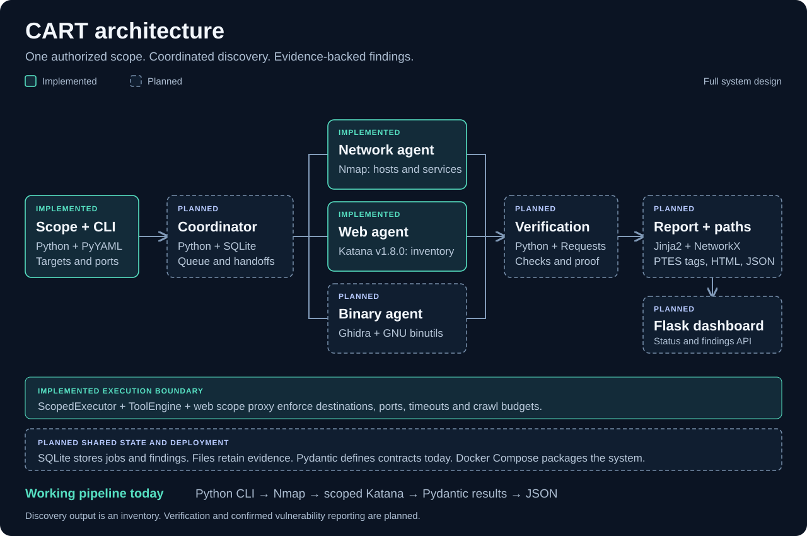
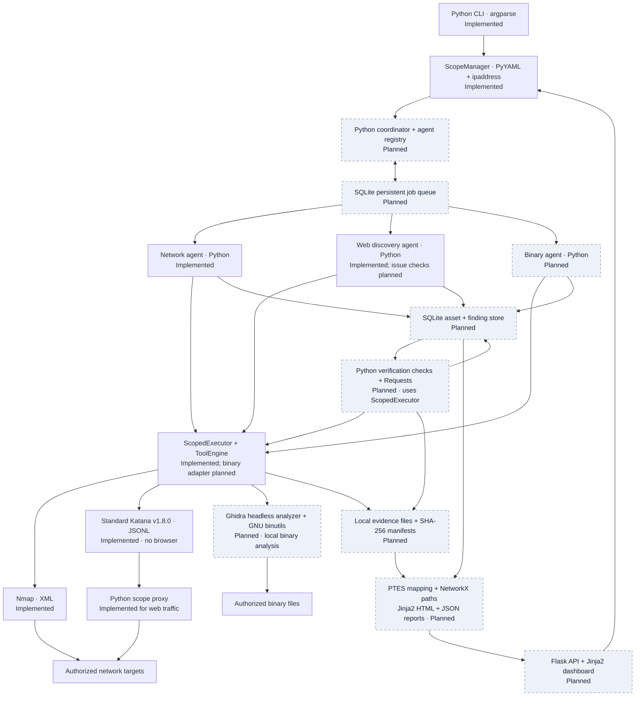
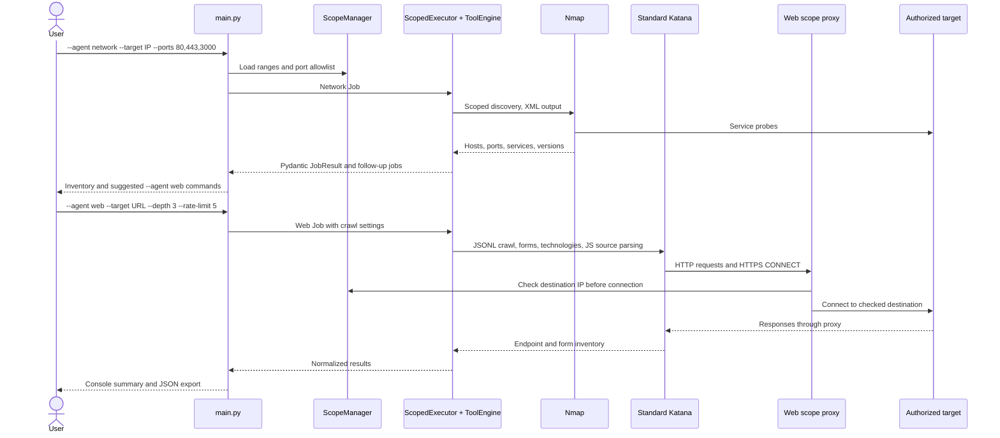
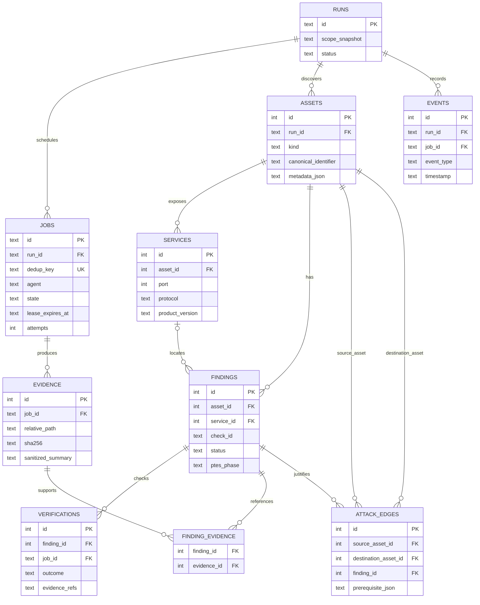
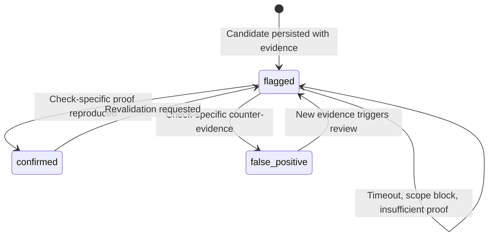
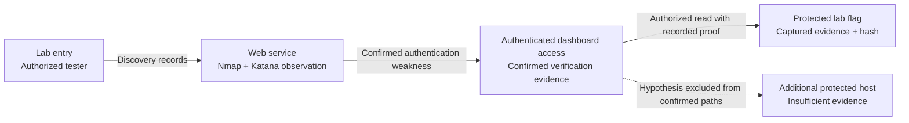
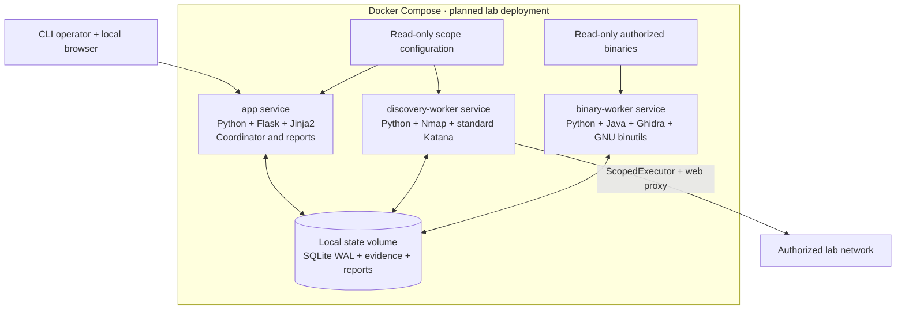

# mitigata-cyberforge

CART automates scoped network and web discovery, with a planned workflow for
binary analysis, verification and PTES-tagged attack-path reporting.

This README is the implementation guide and full build plan. **Implemented**
describes code that runs today. **Partial** means part of the requirement works.
**Planned** describes a selected design that still needs implementation. The scope
is the authorized lab network and the binaries supplied for that lab.

## Contents

- [Architecture](#architecture)
- [Quick start](#quick-start)
- [Functional requirements](#functional-requirements)
- [Selected technologies](#selected-technologies)
- [Execution and handoffs](#execution-and-handoffs)
- [Scope and execution boundary](#scope-and-execution-boundary)
- [Shared data and evidence](#shared-data-and-evidence)
- [Detection and verification](#detection-and-verification)
- [PTES and attack paths](#ptes-and-attack-paths)
- [API and dashboard](#api-and-dashboard)
- [Deployment](#deployment)
- [Implementation roadmap](#implementation-roadmap)
- [Testing and success criteria](#testing-and-success-criteria)
- [Repository map](#repository-map)

## Architecture



**Working today:** one Python command runs Nmap, hands discovered HTTP/HTTPS
services to standard Katana, and exports a normalized JSON inventory. Scope checks
and crawl budgets apply throughout execution.

**Planned:** persistent job coordination, binary analysis, evidence-backed
verification, shared storage, attack-path reports and a findings dashboard.
The diagram names the selected technologies for the complete design.

The following diagram shows the **target architecture**. Boxes marked planned
are not connected to the current runtime yet. Agents pass typed results and
follow-up jobs; every network action goes through the execution boundary.



Ghidra's headless analyzer processes binary files without a GUI. It does not
introduce a web browser; Katana stays in standard HTTP crawling mode.

## Quick start

### Windows installation

Run these PowerShell commands from the repository root. Install Python 3 first;
Node.js is needed only for the optional local demo websites.

```powershell
python -m pip install -r requirements.txt
winget install --id Insecure.Nmap --exact --source winget --accept-package-agreements --accept-source-agreements
python scripts/install_katana.py
```

Reopen PowerShell after installing Nmap so it picks up the updated PATH. In an
existing terminal, the default installation can be added for that session:

```powershell
$env:Path += ';C:\Program Files (x86)\Nmap'
nmap --version
.\.tools\katana\katana.exe -version
```

The project prefers its local Katana **v1.8.0** binary. A plain `katana` command
may select a different version from PATH. Naabu is not installed or integrated
by these steps: its configuration is an example comment and no Naabu parser
is implemented. Network discovery currently uses Nmap.

### Reproduce the local discovery test

With Node.js installed, start the bundled demo websites:

```powershell
.\start-websites.ps1
```

The script starts the studio on port 3000 and planner on port 3001 when those
ports are free. The default scope permits localhost on port 3000; add port 3001
to `allowed_ports` before scanning the planner. To start just the studio in a
foreground terminal, run `node server.cjs studio 3000`, then use another terminal
for scans. The demo exposes `/inputs` with search, contact and preferences forms.

```powershell
# Nmap only: discover services on authorized local ports
python main.py --agent network --target 127.0.0.1 --ports 3000,8080 --output nmap-test.json

# Katana only: crawl the studio and extract form parameter names
python main.py --agent web --target http://127.0.0.1:3000 --crawl-duration 20 --output katana-test.json

# Crawl the input page directly
python main.py --agent web --target http://127.0.0.1:3000/inputs --crawl-duration 20 --output inputs-test.json

# Combined flow: Nmap, then Katana for services identified as HTTP/HTTPS
python main.py --agent all --target 127.0.0.1 --ports 3000 --output combined-test.json

# Read the exported endpoint and form inventory
$report = Get-Content katana-test.json -Raw | ConvertFrom-Json
$report.web.endpoints | Select-Object method, url, status, classification
$report.web.endpoints.forms | Format-List action, method, fields
```

On October 31, 2026, the studio root crawl returned **4 endpoints and 3 forms**:
search (`q`, `category`, `page`), contact (`name`, `email`, `website`, `message`,
`source`) and preferences (`view`, `sort`, `due`, `completed`, `priority`). Counts
can vary with crawl timing and deduplication. A missing `/login` is a 404 probe,
not a discovered login page. No technology fingerprint was detected on this
static demo; that does not imply the crawl failed. Repeated `[scope] ALLOWED`
lines are connection checks, not additional endpoints.

**Known limitations verified locally:**

- Katana v1.8.0 with `-known-files all` missed the linked input page through the
  scope proxy. That option is disabled; automatic discovery of unlinked robots
  and sitemap routes is not guaranteed. Standard Katana does not execute JS.
- The Windows package installed Nmap 7.80. It detected port 3000 open but
  mislabeled this Node demo as `nagios-nsca`, so the combined flow did not
  schedule Katana for it. Use the explicit web command above for known web URLs.
  A separate controlled Python HTTP server on port 8080 was correctly identified
  as `http` / `SimpleHTTPServer 0.6` through the project engine and parser.
- A successful command means its job finished; it does not establish complete
  endpoint coverage or confirm vulnerabilities. Inspect exported forms and
  endpoint statuses against the target's known behavior.

### Scan an authorized lab target

Run from the repository root with Python 3 and the requirements installed:

```powershell
python -m pip install -r requirements.txt
python scripts/install_katana.py
python main.py --target 10.152.241.236 --output results.json
```

Nmap must also be installed and available on PATH. The command scans the ports
listed in `config/scope.yaml`, then automatically runs **standard Katana** for
every detected TCP HTTP/HTTPS service. No headless browser is used. Results include
network services, web findings, endpoints, forms and detected technologies.
Without `--output`, results are printed only. HTTPS services keep their scheme
even on nonstandard ports. Targets must be authorized in the scope file; this
command does not add targets automatically. Include custom web ports such as
3000 in `allowed_ports` so Nmap can discover them.

Run Nmap separately and inspect the suggested web commands it prints:

```powershell
python main.py --agent network --target 10.152.241.236 --ports 80,443,3000 --output network.json
```

Run standard Katana through the engine without starting Nmap:

```powershell
python main.py --agent web --target http://10.152.241.236:3000 --output web.json
python main.py --agent web --target http://10.152.241.236:3000/inputs --depth 3 --rate-limit 5 --concurrency 2 --crawl-duration 20 --request-timeout 8 --max-endpoints 500 --output inputs.json
```

`--agent all` explicitly selects the default network-then-web flow. Web mode
requires an HTTP(S) URL with its port if nonstandard. It prints endpoint
methods/statuses, technology hints and form parameter names. JSON output retains
the complete normalized inventory. Both modes enforce scope; `--ports` selects a
subset of `allowed_ports`. Web mode also checks the URL port against that list.
For virtual hosts, provide the hostname URL to preserve TLS SNI and Host; its
resolved addresses must be in scope.

Crawl controls: depth 1–10, rate 1–100 requests/second, concurrency 1–10,
crawl duration 1–30 seconds per seed, request timeout 1–30 seconds, retained
endpoints 1–10000. The process timeout remains 60 seconds per batch; technology
discovery may schedule one extra batch. `python main.py --help` lists options.

If no web services are detected, Katana is skipped. Exit code 0 means all jobs
completed, 1 means setup/network/output failure, and 2 means incomplete web or
network results. Web jobs run sequentially; a failed one does not stop the rest.
See [web discovery details](docs/web-surface.md) for coverage and crawl budgets.

Offline checks for the engine entry point and Katana integration:

```powershell
python -m pytest tests/test_main.py tests/core/test_katana.py core/test_tool_engine.py tests/agents -q
```

### CLI parameters

| Argument | Purpose | Default |
| --- | --- | --- |
| `--agent network` | Run Nmap and print separate web scan commands | Explicit mode |
| `--agent web` | Run standard Katana without Nmap | Explicit mode |
| `--agent all` | Run Nmap, then discovered web jobs sequentially | Default mode |
| `--target` | Network IP/CIDR; HTTP(S) URL in web mode | `127.0.0.1` |
| `--scope` | Authorized target ranges and allowed ports | `config/scope.yaml` |
| `--ports` | Comma-separated Nmap ports within the scope allowlist | Scope ports |
| `--depth` | Katana crawl depth, 1–10 | 3 |
| `--rate-limit` | Katana requests/second, 1–100 | 5 |
| `--concurrency` | Katana fetchers, 1–10 | 2 |
| `--crawl-duration` | Katana seconds per seed, 1–30 | 30 |
| `--request-timeout` | Katana request timeout in seconds, 1–30 | 8 |
| `--max-endpoints` | Retained normalized endpoints, 1–10000 | 500 |
| `--output` | JSON export containing network and web results | Print only |

Example scope file; replace these addresses with the authorized lab scope:

```yaml
targets:
  - 10.152.241.236/32
  - 127.0.0.1/32
allowed_ports: [22, 80, 443, 3000, 8080]
```

Output currently has `network` and `web` keys. Web-only mode sets `network` to
`null`. Each web item contains the job, typed agent result and normalized
`endpoints`. Endpoints retain methods, statuses, technology hints, form actions,
form parameter names and discovered query/body parameter names. Raw request
bodies, cookies and form values are excluded from normalized output. URL query
values can still appear in endpoint URLs.

## Functional requirements

The source requirements are in [the PRD](PRD_Autonomous_Pentest_Engine.md).
This table includes every mandatory requirement and the evidence needed to
consider it complete. An inventory record is not a confirmed vulnerability.

| ID | Requirement | Current status | Selected implementation and completion check |
| --- | --- | --- | --- |
| FR-1 | Discover live hosts, open ports and services in scope | Implemented for current Nmap discovery pass | Nmap XML becomes typed host/service records. Lab fixtures must prove host, port, protocol, service and available version extraction; rejected scope must prevent launch. |
| FR-2 | Crawl web apps, enumerate endpoints and inputs, flag common issues | Partial: discovery implemented; issue detection planned | Standard Katana discovers links, forms, technology hints and JS source URLs. Add Python checks for reflected markers, missing security headers and authentication candidates. Lab tests must find `/login`, `/admin` and a form, then produce evidence-backed candidate findings. |
| FR-3 | Inspect supplied binaries for weaknesses | Planned | Ghidra headless analysis plus GNU `strings`, `readelf` and `objdump`; ELF and PE format-aware adapters. Findings must reference offsets/functions and distinguish suspicious strings from proven weaknesses. |
| FR-4 | Coordinate agents and share findings without repeated work | Partial: sequential handoffs and per-run web job deduplication implemented | Python coordinator, Pydantic contracts and SQLite queue. Atomic job claims, stable deduplication keys, durable results and follow-up insertion must survive process restart without duplicating completed work. |
| FR-5 | Map each step to a PTES phase | Planned | Explicit Python/YAML phase lookup in `reporting/ptes.py`. Every job event and finding gets a phase; unmapped check types fail validation rather than receiving a guessed phase. |
| FR-6 | Verify findings instead of reporting guesses | Planned | Python verifier performs bounded, check-specific replays through ScopedExecutor. Expected observations plus retained evidence determine `confirmed`, `false_positive` and retained `flagged` results. |
| FR-7 | Produce one report with an attack path, expose an API/page and document setup | Partial: CLI JSON output and setup documentation implemented | Jinja2 HTML report, NetworkX attack graph, Flask findings API and dashboard. One run must produce an evidence-linked report and serve `GET /targets/5/findings` from persisted data. |

### Bonus requirements

These are committed follow-on design items, scheduled after the mandatory
requirements. Their completion is not claimed by the current discovery CLI.

| ID | Requirement | Status | Planned implementation and acceptance check |
| --- | --- | --- | --- |
| B-1 | Capture planted lab flags | Planned | Configured flag patterns and evidence references; retain the source asset and capture action. Match known lab flags without scanning outside scope. |
| B-2 | Chain findings to a protected crown-jewel host | Planned | NetworkX directed graph with explicit access prerequisites. Every reported reachable step must have confirmed evidence; hypothetical paths remain labelled. |
| B-3 | Suggest plain-English fixes | Planned | Reviewed remediation templates keyed by finding type and detected technology. Every confirmed check type has a specific corrective action and retest guidance. |
| B-4 | Add agents/checks through configuration | Partial foundation: tool commands and parsers are configurable | Extend the existing YAML registry with validated preinstalled agent/check entry points. Enable a prepared plugin through configuration without changing coordinator code. New behavior still requires a plugin implementation. |
| B-5 | Display live agent activity and findings | Planned | Flask server-sent events, Jinja2 pages and vanilla JavaScript. Show job states, coverage gaps and findings; reconnect using persisted event IDs. |

## Selected technologies

One technology is selected for each responsibility; this plan does not require
an LLM service or a separate distributed queue service.

| Responsibility | Technology | Status |
| --- | --- | --- |
| Runtime and CLI | Python 3, `argparse` | Implemented |
| Shared contracts | Pydantic | Implemented |
| Scope and configuration | PyYAML, Python `ipaddress` | Implemented |
| Tool execution | Python `subprocess`, configured argv, process timeouts | Implemented |
| Network discovery | Nmap, Python XML parser | Implemented |
| Web discovery | Standard Katana v1.8.0, JSONL parser | Implemented |
| Web destination enforcement | Python HTTP proxy and checked sockets | Implemented |
| Web issue checks and verification | Python, Requests through ScopedExecutor | Planned; Requests is listed in requirements |
| Binary metadata and strings | GNU binutils | Planned |
| Binary decompilation and function references | Ghidra headless analyzer with Java runtime | Planned |
| Coordination | Python agent registry and worker pool | Planned |
| Persistence and job queue | SQLite through Python `sqlite3`, WAL mode | Planned |
| Evidence | Local files, SHA-256 manifests and database references | Planned |
| Attack graph | NetworkX directed graph | Planned |
| API | Flask | Planned; dependency listed |
| Reports and dashboard templates | Jinja2 | Planned |
| Dashboard updates | Server-sent events and vanilla JavaScript | Planned |
| Reproducible lab packaging | Docker Compose | Planned |
| Automated checks | pytest | Implemented; full-system fixtures planned |

Version pins for installed Python dependencies live in `requirements.txt`.
Ghidra, binutils, Java, NetworkX and deployment images will receive tested
version pins when their milestones are implemented. Their presence in this
table does not mean they are installed by the current setup command.

## Execution and handoffs

### Current manual workflow

This is the supported path for inspecting Nmap output before choosing a URL and
Katana parameters. The engine does not need to run Nmap again for the web step.



In `--agent all` mode, `main.py` executes the web follow-ups automatically.
The current flow is sequential and in memory. It is not a persistent worker
scheduler and it does not yet run binary jobs or verification.

### Planned autonomous workflow

1. Create a run, freeze the authorized scope snapshot and seed network/binary jobs.
2. Claim pending jobs atomically using SQLite transactions and worker leases.
3. Execute agents through the shared execution boundary with per-tool budgets.
4. Validate `JobResult`, persist assets, attach evidence and enqueue deduplicated follow-ups in one transaction.
5. Run configured issue checks against discovered services, inputs and binaries.
6. Schedule verification jobs for candidates; retain inconclusive observations.
7. Apply PTES phases and construct evidence-linked access relationships.
8. Produce the report when the queue drains; retain resumable state if the run stops.

Job identity will include run, agent, canonical target, check ID and relevant
configuration hash. At-least-once execution is expected after a worker crash;
idempotent writes and check-specific replay rules prevent duplicate findings.
Lease expiry requeues eligible jobs, bounded retries end in failure, and run
cancellation stops new claims and terminates active tool processes.

## Scope and execution boundary

Scope is an execution constraint, not a result filter alone. The planned
coordinator must enforce the same rules in every agent and verifier.

| Layer | Current behavior | Remaining work |
| --- | --- | --- |
| Run input | IP/CIDR scope and allowed ports loaded from YAML | Persist immutable scope snapshots and audit events per run |
| Network scan | Target checked before Nmap; explicit ports passed; returned host IPs rechecked | Add deployment-level egress restrictions and tests for every tool's network behavior |
| Web job | URL validation; CLI port validation; DNS addresses checked | Apply a shared port policy to every future direct API/worker entry point |
| Web traffic | Exact host/port proxy, checked destination sockets, external redirects/resources blocked | Persist blocked-request reasons and expose coverage gaps |
| Tool launch | Argv execution, return-code/error detection, response/crawl budgets, process timeout | Unified cancellation, resource accounting and persistent tool evidence |
| Binary analysis | No runtime implementation | Authorize file paths and SHA-256 hashes; mount inputs read-only; isolate execution checks |

Nmap's preflight and post-result checks are not a per-packet firewall. HTTP scope
proxy enforcement is implemented for Katana; it must not be assumed to protect
tools that are not routed through it. HTTPS CONNECT is an end-to-end TLS tunnel,
so the proxy enforces destination addresses rather than inspecting encrypted paths.

Standard Katana does not execute JavaScript. Runtime-only requests, dynamically
created forms, shadow DOM and interaction-only routes can be missed. Its form
records expose parameter names rather than a complete inventory of widget types.
External SSO and cross-origin resources are blocked by the current origin policy.
CAPTCHA pages, bot challenges and soft 404 responses may look like ordinary HTTP
200 pages; universal challenge bypass and exhaustive discovery are not promised.

## Shared data and evidence

The following is the **planned SQLite schema**, not the current JSON export
format. Entity relationships preserve provenance from a finding back to its job,
asset and evidence. Endpoint/form details will be stored as structured JSON
metadata on assets until query needs justify separate tables.



Current shared contracts are `Job`, `JobResult`, `HostOut`, `ServiceOut`,
`FindingOut`, `Evidence` and `StoredFinding` in `common/contracts.py`. Schema
extensions will be versioned with migrations and validated at the API boundary.

The evidence store will use `runs/<run-id>/evidence/<sha256>` files with a
manifest recording tool version, arguments with secrets removed, target, time,
check ID, scope decision and content hash. Database records hold sanitized
summaries and references, not large response bodies. Evidence reads must resolve
inside the selected run directory. Reports will redact credentials and tokens;
raw artifacts require restricted access and an explicit retention policy.

## Detection and verification

Discovery inventories and vulnerability findings serve different purposes. A
reachable admin path, a technology banner, a reflected string and a suspicious
binary import are observations. They need a check-specific proof before a
vulnerability can be marked confirmed.

| Surface | Planned candidate checks | Confirmation requirement |
| --- | --- | --- |
| Network | Match exposed services to configured lab weakness checks | A service-specific response proves the behavior; a version banner alone is insufficient |
| Web | Missing header checks, reflected-marker checks, authentication candidates | Capture the relevant response and expected observation; input reflection alone does not establish executable XSS |
| Authentication | Configured lab account/default-credential candidates | Verify authenticated access to a protected resource, not only a redirect or HTTP 200 |
| Binary | Hard-coded credential candidates, unsafe functions and missing mitigations | Trace the string/function to reachable behavior; use an isolated seeded fixture for execution-based proof |

Python/Requests verification must be exposed through ScopedExecutor with manual
redirect validation and the same destination/port policy as discovery. The
verifier must not create its own unguarded network client. Ghidra decompilation
and binutils metadata provide static evidence; controlled binary execution
checks run in a network-disabled container with explicit resource limits.



These three finding states already exist in the shared contract. Verification
job progress is tracked separately from finding status. An HTTP error, timeout
or blocked request must not automatically label a candidate false positive.
Verification attempts retain their evidence, observation and failure reason.

## PTES and attack paths

| PTES phase | Planned engine responsibility |
| --- | --- |
| Pre-engagement interactions | Authorized scope snapshot, limits and run configuration |
| Intelligence gathering | Nmap discovery and Katana surface inventory |
| Threat modeling | Asset roles, service relationships and explicitly configured access prerequisites |
| Vulnerability analysis | Candidate checks and static binary analysis |
| Exploitation | Bounded verification actions that prove authorized lab weaknesses |
| Post-exploitation | Authorized flag evidence and confirmed access progression |
| Reporting | Findings, evidence, remediation and attack-path report |

Phase tags describe actions, not severity. Opening a port does not establish
an exploitation step. The planned NetworkX graph will connect assets and access
states only when prerequisites and supporting findings are recorded.



This is an illustrative lab path, not a claim about a scanned target. Reports
will distinguish confirmed access chains from hypotheses, include evidence links
for every confirmed edge and stop chains whose prerequisites are not satisfied.

## API and dashboard

The Flask API and dashboard are planned. The route table defines the intended
contract; these routes are not currently served by the repository.

| Method and route | Planned behavior |
| --- | --- |
| `POST /runs` | Validate a registered scope and create the first jobs |
| `GET /runs/<id>` | Return state, timing, limits and coverage counts |
| `POST /runs/<id>/cancel` | Stop new work and cancel active subprocesses |
| `GET /runs/<id>/jobs` | List agent jobs, attempts and failure reasons |
| `GET /runs/<id>/events` | Stream persisted event IDs with server-sent events |
| `GET /targets/<id>/findings` | Return filtered finding status, PTES phase and evidence summaries |
| `GET /runs/<id>/report` | Serve the generated Jinja2 HTML report |
| `GET /runs/<id>/report.json` | Download the structured report |

Flask will bind to loopback by default. A configured bearer token protects
run-control and evidence endpoints. Jinja2 pages show asset inventory, jobs,
findings, evidence summaries and paths. Vanilla JavaScript updates progress from
the event stream. New API inputs must not silently expand an authorized scope.

## Deployment

Native Python execution is supported today. This is the **planned Docker Compose
layout**; Compose files and worker entry points are not implemented yet.



SQLite remains on a local filesystem shared by a small number of processes;
WAL mode, short transactions and bounded worker counts are deliberate. This
design does not depend on network-filesystem locking. The binary worker has no
target-network access. Deployment must validate target routing, Nmap permissions,
scope enforcement and subprocess cancellation inside the lab environment.

## Implementation roadmap

Work proceeds in dependency order. Each milestone ends with a runnable demo and
recorded acceptance results; unimplemented commands will not be advertised as
available CLI features.

| Milestone | Deliverables and modules | Completion gate |
| --- | --- | --- |
| M0 — Discovery baseline | Current CLI, Nmap, standard Katana, scope proxy, typed contracts and JSON export | Network-only, web-only and combined modes work; fixtures assert endpoints/forms and scope refusal. Current foundation; not full PRD completion. |
| M1 — Durable shared state | `core/db.py`, schema migrations, run snapshots, evidence manifests and events | A run can be reopened after process restart; duplicate asset/finding writes converge; evidence hashes validate. |
| M2 — Agent coordination | `core/queue.py`, `core/orchestrator.py`, worker registry, leases, retries and cancellation | Network discovery automatically schedules one web job per canonical service; crashes do not create duplicate findings; cancellation stops active jobs. |
| M3 — Web issue checks | Configured Python checks, scoped verification HTTP methods, per-check evidence | Seeded positive/negative pages distinguish observation from a candidate weakness; rate limits and external redirects remain enforced. |
| M4 — Binary surface | `agents/binary/agent.py`, Ghidra exports, binutils parsers, authorized file manifests | ELF and PE fixtures produce function/offset evidence; unsupported/corrupt files fail clearly; analysis does not execute inputs. |
| M5 — Verification | `verification/verifier.py`, check-specific assertions, isolated binary proof fixtures | Positive, negative and inconclusive fixtures produce correct finding states; every confirmed finding has replayable proof. |
| M6 — PTES and reporting | `reporting/ptes.py`, `reporting/report_generator.py`, NetworkX path builder, Jinja2 templates | One evidence-linked HTML/JSON report covers all three surfaces, flags coverage gaps and excludes hypothetical edges from confirmed paths. |
| M7 — API and reproducible run | `api/routes.py`, authenticated local Flask API, dashboard, Docker Compose and setup documentation | A fresh lab checkout runs from documented setup; API findings match report data; packaged workers enforce scope. |
| M8 — Bonus capabilities | Flag capture, validated chains, remediation templates, config plugin activation and live progress | Each B-1 through B-5 acceptance check passes on the planted lab fixtures; live progress reflects persisted events. |

### Failure cases included in the plan

- **Scope changes and DNS:** retain the original scope snapshot; validate each web connection; reject unauthorized target/port expansions at every entry point.
- **Web behavior:** classify 401/403 and 429; keep useful timeout output; surface redirects, unavailable targets, malformed JSONL, crawl truncation and unsupported runtime-only coverage.
- **Technology hints:** schedule a bounded set of matching paths; verify responses; do not infer a URL or vulnerability solely from a framework/language fingerprint.
- **Jobs:** deduplicate canonical targets, recover expired leases, cap retries and stop cleanly after cancellation.
- **Binaries:** validate input path/hash, handle corrupt files and unsupported formats, cap analysis resources and separate static analysis from execution checks.
- **Storage:** use atomic result transactions, check evidence paths/hashes, report disk failures and prevent a partial write from marking a job complete.
- **Verification:** retain inconclusive results as flagged; require protected-resource checks for authentication claims; distinguish reflection from code execution.
- **Reports:** escape target-supplied text, redact secrets and label missing coverage and hypothetical paths.

## Testing and success criteria

Run the offline suite for current CLI and discovery behavior:

```powershell
python -m pytest tests/test_main.py tests/core/test_katana.py core/test_tool_engine.py tests/agents -q
```

Opt into the real Katana tests against local HTTP fixtures:

```powershell
$env:KATANA_LIVE_TESTS = '1'
python -m pytest tests/core/test_katana.py tests/test_main.py -k live -q
```

`python -m pytest -q` runs the complete repository suite, including legacy tests.
The opt-in pipeline test supplies an Nmap fixture and runs real Katana; it does
not prove a real Nmap scan. A full lab acceptance run must exercise both installed
binaries and all planned agents. An empty result is not evidence of full coverage.

Verification on October 31, 2026: the focused command above with
`KATANA_LIVE_TESTS=1` passed **65 tests**. The full default repository suite
returned **67 passed, 10 failed, 2 skipped**. Nine legacy tests still call the
removed `RealScopedExecutor._parse_nmap_xml` method instead of
`core.parsers.nmap.parse`; another expects an older missing-Nmap exception.
That legacy guard test may invoke a real nonlocal scan if Nmap is on PATH, so
use the focused suite for the documented localhost verification workflow until
those tests are updated. Full-suite green status is not claimed.

Planned test layers are parser/contract unit tests, scope-proxy integration tests,
SQLite queue/restart tests, seeded positive/negative verification fixtures, binary
analysis fixtures, API/report checks and a reproducible lab end-to-end run.

PRD score targets are acceptance goals, not current measured achievements:

| Measure | Qualification target | Stretch target |
| --- | --- | --- |
| Planted host/service coverage | Above 70% | Above 90% |
| Planted weakness detection | Above 60% | Above 85% |
| Verified share of findings | At least half | All reportable findings |
| False-positive share | Below 30% | Below 10% |
| Out-of-scope probes | Zero as the engine's release requirement | Zero |
| Full lab runtime | Below one hour | Below 20 minutes |
| Autonomy | One start command | No intervention during the run |

Scope refusal and reproducible proof are release gates, not scoring tradeoffs.
Coverage is calculated against the organizers' planted ground truth when provided;
the number of discovered URLs alone does not establish a coverage percentage.

## Repository map

| Location | Responsibility | Status |
| --- | --- | --- |
| `main.py` | CLI modes, parameter validation, sequential handoff and JSON export | Implemented |
| `common/contracts.py` | Pydantic jobs, results, assets and finding contracts | Implemented foundation |
| `scope/manager.py` | Scope configuration, IP/CIDR checks and logging | Implemented |
| `core/tool_engine.py` | Configured external tools and Python adapters | Implemented |
| `core/scoped_executor.py` | Agent execution boundary | Network/web implemented |
| `core/katana.py` | Katana lifecycle, budgets and technology path candidates | Implemented |
| `core/web_scope_proxy.py` | Checked destination sockets and origin boundary | Implemented |
| `core/parsers/` | Nmap XML and Katana JSONL normalization | Implemented |
| `agents/network/agent.py` | Host/service inventory and web follow-up jobs | Implemented |
| `agents/web/agent.py` | Web inventory findings and status | Discovery implemented |
| `agents/binary/agent.py` | Binary analysis agent | Empty placeholder |
| `core/db.py`, `core/queue.py`, `core/orchestrator.py` | Persistent state and scheduling | Empty placeholders |
| `verification/verifier.py` | Finding proof and status transitions | Empty placeholder |
| `reporting/ptes.py`, `reporting/report_generator.py` | PTES tags and final reports | Empty placeholders |
| `api/routes.py` | Flask API | Empty placeholder |
| `config/scope.yaml`, `config/tools.yaml` | Scope and tool configuration | Implemented |
| `scripts/install_katana.py` | Checksum-verified pinned binary installer | Implemented |
| `tests/` and `core/test_tool_engine.py` | CLI, agent, scope and tool verification | Implemented foundation |
| `docs/architecture.svg`, `docs/web-surface.md` | Architecture overview and crawler details | Documentation |

The standalone demo web pages in the workspace are test targets; they are not
the planned Flask findings dashboard.
